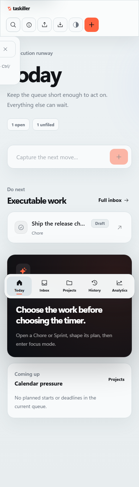

# Taskiller UI/UX audit

Date: 18 November 2026. Scope: the SvelteKit web client, its public entry points, authenticated workspace, planning, execution, history, analytics, account settings, and shared UI. This is an audit and improvement backlog; application behavior has not been changed.

## Overall assessment

Taskiller has a recognizable visual identity and a substantial working product underneath it. The orange action color, hierarchy vocabulary, focused execution surface, existing brand assets, and consistent panels give it a foundation worth retaining. The main problem is the distance between that visual confidence and everyday interaction reliability.

The most useful modernization would make Taskiller calmer, faster to act in, and more trustworthy. Prioritize reachable controls, dependable feedback, complete data views, preserved drafts, and an accurate timer. Then simplify visual hierarchy and add restrained motion to explain actual state changes.

**30 consolidated findings: 0 P0, 12 P1, 16 P2, 2 P3.** Related occurrences are grouped rather than counting every failing SVG or every viewport as a separate problem. P1 means a major usability/accessibility problem; P2 means friction with a workaround; P3 means visual refinement. No universal task-blocking failure was established.

| Technical dimension | Indicative score, 0–4 | Assessment |
| --- | --- | --- |
| Accessibility | 1 | Contrast, icon semantics, dialog focus, unnamed controls, and chart alternatives need systemic work. |
| Performance | 2 | Build succeeds; unbounded lists, per-card requests, global imports and animated effects present scaling risks. Field performance was not measured. |
| Responsive behavior | 2 | Main pages reflow, but mobile search is off-screen and account navigation disappears below the desktop breakpoint. |
| Theming | 3 | Broad light/dark support works; semantic tokens are undermined by class-string overrides and isolated contrast failures. |
| Implementation integrity | 2 | Coherent identity, but feedback, error states, navigation state, and component semantics vary by surface. |
| Total | **10/20** | Significant work needed. This is a qualitative engineering assessment, not a usability-study or Lighthouse score. |

**Identity verdict:** preserve the brand and product model. The working application currently inherits too much landing-page presentation: large editorial headings, atmospheric backgrounds, spacious cards, repeated motivational copy, and utility controls competing with the task. Make the workspace behave like a focused tool; reserve larger expression for the public landing page and meaningful milestones.

## Method and evidence

Skills used:

- [Impeccable](C:/Users/kmab5/.agents/skills/impeccable/SKILL.md), particularly its technical audit playbook, for accessibility, performance, theming, responsiveness, and implementation integrity.
- [Web Design Guidelines](C:/Users/kmab5/.agents/skills/web-design-guidelines/SKILL.md), checked against the [current upstream guidelines](https://raw.githubusercontent.com/vercel-labs/web-interface-guidelines/main/command.md).
- [webapp-testing](C:/Users/kmab5/.agents/skills/webapp-testing/SKILL.md), applying browser inspection and interaction probes. The repository's existing TypeScript Playwright tools and fixtures were reused.

Validation completed:

- `npm run check`: zero errors and zero warnings.
- Production builds completed through Playwright's configured web-server startup.
- `npm run test:e2e`: **18/18 passed**, across desktop Chromium and Pixel 7 emulation.
- Additional audit-only Playwright run: **28 route/viewport combinations**, screenshots, axe scans, browser errors, and focused interaction probes.
- Routes rendered at 1440px and 390px: landing, login, registration, Today, Inbox, Projects, History, Analytics, Settings, Chore detail, Chore planning, and a running session. Landing, Today, Projects, and session also rendered at 320px.
- Additional navigation checks at 768px, 1024px and 1280px; a 640px layout check; dark-mode scans of Today, Analytics and Login; reduced-motion inspection; failed-capture, search, modal, tab persistence, and timer-resume probes.
- Impeccable source detector over `src`: one advisory for the decorative grid background at `src/app.css:183`. The earlier markup-only scan produced no findings. Neither result is an accessibility or usability pass.

Evidence: [axe/layout/interaction results](ui-ux-audit/evidence.json), [additional probes](ui-ux-audit/probes.json), and [detector output](ui-ux-audit/impeccable-detector.json).

The additional audit used mocked API responses, including a synthetic Chore and session. Existing list fixtures are deliberately minimal and do not reproduce a complete production hierarchy. Findings about hierarchy completeness, pagination, drafts, and large-account behavior are grounded in source inspection rather than claims of live-backend reproduction. No production records were created or changed. Safari, Firefox, actual mobile keyboards, screen-reader speech, real 200% browser zoom, and network/CPU performance profiling remain untested. The 640px check is a layout approximation, not a claim of zoom conformance.

Screenshots retain the existing mock account and demonstrate layout, not production data. Fixed navigation appears at its viewport position in full-page captures; that alone does not prove the final page content is unreachable.

## Major findings — P1

### F01. Mobile search opens mostly outside the viewport

**Evidence: browser verified.** At 390px, the search panel has `x = -309px`, width `366px`. The right-aligned panel is anchored to a utility button near the left side of the wrapped header. Most of the search field and results are clipped.

Location: [WorkSearch.svelte:74](../src/lib/components/layout/WorkSearch.svelte#L74). Category: responsive behavior, task completion.

Recommendation: use a viewport-aligned mobile sheet or full-width search panel. Keep the desktop anchored popover where there is room. Test actual panel bounds, typing, result activation, and keyboard visibility at 320–430px. Escape currently removes the input and leaves focus on `body`; return focus to the trigger.

Acceptance: the entire search surface stays within the viewport and closes back to its trigger. Suggested workflow: `$impeccable adapt`, then `$impeccable harden`.

### F02. Account navigation disappears on phones and tablets

**Evidence: browser and source verified.** Visible Settings links exist at 1440/1280px but not at 390/768/1024px. Settings, Profile and the shell's sign-out button are inside `xl:block`; the alternative shell provides none of them. The routes still exist, and Settings has device sign-out controls if reached directly, but the primary navigation does not expose them.

Location: [AppShell.svelte:99](../src/lib/components/layout/AppShell.svelte#L99), [mobile header:105](../src/lib/components/layout/AppShell.svelte#L105). Category: navigation, responsive parity.

Recommendation: add an account/menu entry visible at every breakpoint. Group profile, appearance, settings, portability, help and sign-out inside it. Keep capture and search readily available.

Acceptance: a phone user can reach Settings and sign out without typing a URL. Suggested workflow: `$impeccable adapt`.

### F03. Quick capture fails silently

**Evidence: browser verified with a mocked HTTP 503.** The request fails, the entered text remains, and the button becomes available again, but there is no alert or recovery message. `capture` implements `onSuccess` only and the page never renders its error.

Location: [Today:28](../src/routes/(app)/today/+page.svelte#L28), [capture form:89](../src/routes/(app)/today/+page.svelte#L89). Category: feedback, error recovery.

Recommendation: render an adjacent error with Retry, retain the draft, announce the outcome, and prevent duplicate submission while pending. Do not queue offline mutations or add retries that bypass existing idempotency behavior.

Acceptance: 4xx/5xx/offline failures are visible, actionable, and preserve input. Suggested workflow: `$impeccable harden`.

### F04. Custom modals do not implement modal keyboard behavior

**Evidence: browser and source verified.** Export opens with focus still on the background Export button. Escape leaves it open. Work Type manager opens with focus outside the dialog; the next Tab also remains outside. Work Type manager supports Escape, but not initial focus, focus containment, background inertness, or explicit focus return. Import shares the export overlay implementation and has the same structural gaps.

Location: [PortableWorkSettings.svelte:143](../src/lib/components/settings/PortableWorkSettings.svelte#L143), [import:199](../src/lib/components/settings/PortableWorkSettings.svelte#L199), [WorkTypeManager.svelte:176](../src/lib/components/work/WorkTypeManager.svelte#L176). Category: accessibility, interaction integrity.

Recommendation: create one reusable accessible dialog primitive with initial focus, contained Tab order, inert background, appropriate Escape handling, focus return and scroll management. Preserve protection during an in-flight import.

Acceptance: keyboard users enter, operate and close each dialog without interacting with the obscured page. Align with the [WAI modal dialog pattern](https://www.w3.org/WAI/ARIA/apg/patterns/dialog-modal/). Suggested workflow: `$impeccable harden`.

### F05. Text contrast fails across operational surfaces

**Evidence: axe verified.** Examples: Work Type management link approximately **2.59:1**, neutral status text **4.13:1**, Settings secondary copy around **4.27:1**. The running-session scan reports ten contrast failures, including important supporting text around **2.48–3.56:1**. Dark Analytics still has a calibration note at approximately **3.81:1**. Values depend on the tested backgrounds and state.

Location: [WorkTypeSelect.svelte:35](../src/lib/components/work/WorkTypeSelect.svelte#L35), [Badge.svelte:15](../src/lib/components/ui/Badge.svelte#L15), [session:244](../src/routes/(app)/session/[id]/+page.svelte#L244), [Analytics](../src/routes/(app)/analytics/+page.svelte). Category: accessibility, theming.

Recommendation: define readable secondary, tertiary, accent-link and inverse-text tokens. Avoid using low white opacity for meaningful small text. Validate foreground/background combinations in both themes. Disabled controls are not counted as ordinary contrast failures here.

Acceptance: ordinary meaningful text meets the applicable [WCAG contrast threshold](https://www.w3.org/WAI/WCAG22/Understanding/contrast-minimum.html). Suggested workflow: `$impeccable colorize`, `$impeccable harden`.

### F06. Decorative icons are exposed as unnamed images

**Evidence: axe verified across most surfaces.** Phosphor icons render `role="img"` without names. A parent button's accessible label does not remove the unnamed child image. Today at desktop width has 17 flagged icon nodes; the running session has eight. These are repeated instances of one systemic problem, not dozens of separate findings.

Location: [AppShell.svelte:85](../src/lib/components/layout/AppShell.svelte#L85), [WorkSearch.svelte:69](../src/lib/components/layout/WorkSearch.svelte#L69), [WorkItemRow.svelte:77](../src/lib/components/work/WorkItemRow.svelte#L77), and feature components. Category: accessibility.

Recommendation: hide decorative icons with `aria-hidden="true"`; name genuinely informative standalone graphics. Apply the convention consistently through shared icon usage or review guidance.

Acceptance: axe no longer reports `svg-img-alt`, while every icon-only action retains a meaningful accessible name. Suggested workflow: `$impeccable harden`.

### F07. Some fields and grouped choices lack meaningful accessible labels

**Evidence: browser and source verified.** History's state filter triggers axe `select-name` at desktop and phone widths. Verification-token and account-deletion phrase inputs have nearby instructional text but no associated label. WorkComposer relies on placeholder text instead of a stable name label. Session review presents four sets of buttons named only 1–5 without a semantic group label or verbal scale endpoints.

Location: [History:114](../src/routes/(app)/history/+page.svelte#L114), [verify-email:51](../src/routes/verify-email/+page.svelte#L51), [DataPrivacySettings.svelte:176](../src/lib/components/settings/DataPrivacySettings.svelte#L176), [WorkComposer.svelte:100](../src/lib/components/work/WorkComposer.svelte#L100), [SessionReviewForm.svelte:71](../src/lib/components/execution/SessionReviewForm.svelte#L71). Category: accessibility, forms.

Recommendation: add associated visible labels, meaningful field names and fieldset/legend grouping. Label scores in context, such as “Focus, 4 of 5,” and explain low/high endpoints.

Acceptance: controls remain understandable when navigated independently or after placeholders disappear. Suggested workflow: `$impeccable clarify`, `$impeccable harden`.

### F08. Editing and planning drafts can be lost on navigation

**Evidence: source verified.** WorkEditor, WorkComposer, Focus Plan editing and account forms keep drafts in local component state without dirty-state navigation protection. The only `beforeNavigate`/`beforeunload` protection found is for an active portable import.

Location: [WorkEditor.svelte:49](../src/lib/components/work/WorkEditor.svelte#L49), [planning state:43](../src/routes/(app)/work/[id]/plan/+page.svelte#L43), [WorkComposer.svelte:40](../src/lib/components/work/WorkComposer.svelte#L40). Category: user control, error prevention.

Recommendation: track dirty state; warn only when there is unsaved work, or offer scoped draft recovery. Keep draft storage consistent with privacy requirements; do not persist credentials. Replacing a plan by generating/loading another should also protect meaningful edits.

Acceptance: accidental navigation, refresh and plan replacement have a clear recovery path. Suggested workflow: `$impeccable harden`.

### F09. Search and work views silently omit data beyond the first page

**Evidence: source verified.** Search fetches 100 work items, filters locally and displays seven matches without further results. Today and Inbox also use a single 100-item page. Inbox filters root Chores after fetching, so nested Chores can consume the page and hide root work. Projects separately follows all pages. Search also uses `['work-search']`, outside the `['work']` invalidation family used by writes.

Location: [WorkSearch.svelte:18](../src/lib/components/layout/WorkSearch.svelte#L18), [work.ts:47](../src/lib/api/work.ts#L47), [Projects:25](../src/routes/(app)/projects/+page.svelte#L25), [query keys](../src/lib/api/query-keys.ts). Category: findability, trust, data consistency.

Recommendation: provide proper pagination or supported server-side search/filtering; expose result limits honestly and provide “View all results.” Share query-key conventions so new/renamed items appear promptly. If an API change is needed, coordinate it with the Django backend rather than inventing unsupported query parameters.

Acceptance: known items remain findable beyond page one, and search updates after writes. Suggested workflow: `$impeccable harden`.

### F10. A session opened while paused has a frozen countdown after Resume

**Evidence: browser verified.** Open a paused session, choose Resume, and compare the main clock after 2.2 seconds: it stays at **23:00** while session state is running. `ActiveSessionCard` creates its interval only in `onMount`, and returns early if initially paused. The floating timer already uses a state-dependent effect, so the two implementations differ.

Location: [ActiveSessionCard.svelte:13](../src/lib/components/execution/ActiveSessionCard.svelte#L13), [FloatingSessionTimer.svelte:11](../src/lib/components/execution/FloatingSessionTimer.svelte#L11). Category: status accuracy, core interaction.

Recommendation: share a reactive timer model that starts/stops as state changes, resynchronizes on visibility/reconnect, and derives time from server timestamps. Do not replace the backend's authoritative clock with a client timer process.

Acceptance: running, paused-on-load, resumed, reopened and multi-client transitions all render the correct moving/frozen clock. Suggested workflow: `$impeccable harden`.

### F11. Some load failures are shown as legitimate empty or inactive states

**Evidence: source verified.** Today shows “No active session” whenever no session data exists, including while loading or after failure. Project next-action and hierarchy sections lack separate error branches. Search can turn a failed request into “No matching work.” Devices can show “No active sessions were returned” after load failure; Preferences renders defaults after failure.

Location: [Today:134](../src/routes/(app)/today/+page.svelte#L134), [ProjectCard.svelte:45](../src/lib/components/work/ProjectCard.svelte#L45), [work detail:207](../src/routes/(app)/work/[id]/+page.svelte#L207), [WorkSearch.svelte:87](../src/lib/components/layout/WorkSearch.svelte#L87), [SessionsSettings.svelte:77](../src/lib/components/settings/SessionsSettings.svelte#L77), [PreferencesSettings.svelte:118](../src/lib/components/settings/PreferencesSettings.svelte#L118). Category: feedback, error recovery.

Recommendation: distinguish loading, empty, failed, stale and current states. Keep previously loaded data visible with an explicit stale/error message and a local Retry action. Never imply that an API failure proves an account has no devices or an item has no children.

Acceptance: each data surface has a distinct 503 outcome and can recover without a full reload. Suggested workflow: `$impeccable harden`.

### F12. Analytics chart data is inaccessible to keyboard and touch exploration

**Evidence: source verified.** Activity and hour charts encode values in bars, colors and native `title` attributes on nonfocusable `div`s. No equivalent data table or interactive value inspection is provided. The charts impose 620/680px internal widths, which can scroll, but their detail interaction remains desktop-hover oriented.

Location: [ActivityChart.svelte:13](../src/lib/components/analytics/ActivityChart.svelte#L13), [HourPatternChart.svelte:10](../src/lib/components/analytics/HourPatternChart.svelte#L10). Category: accessibility, data comprehension.

Recommendation: provide a concise chart summary and an accessible table or list of exact values. Add keyboard/tap inspection if the visual chart becomes interactive. Preserve understandable labels and units.

Acceptance: a user can obtain the same dates, durations and counts without seeing or hovering the bars. Suggested workflow: `$impeccable harden`, `$impeccable adapt`.

## Usability and system improvements — P2

| ID | Finding and evidence | Specific improvement and acceptance | Source / workflow |
| --- | --- | --- | --- |
| F13 | **Navigation overload and small targets.** The phone header has six utility actions and wraps into two rows at 390px. Many shared icon buttons are 40px; row actions and review choices are 36px. | Keep search, capture and account/menu readily available; move infrequent tools into the menu. Aim for 44px touch controls with comfortable spacing. This is a usability target, not a claim that every sub-44px control fails WCAG AA; its minimum criterion is 24px with exceptions. | `AppShell.svelte:105`, `Button.svelte:38`, `WorkItemRow.svelte:73`, `SessionReviewForm.svelte:82`; `$impeccable adapt`, `$impeccable distill`. |
| F14 | **Workspace scale delays real work.** On the 390px Today capture, the first Chore starts roughly 590px down. Eyebrow, 60px title, subtitle, counters and generous gaps consume the first screen. | Use a more compact application heading, inline summary and earlier capture/list placement. Keep larger display type for the landing page. Acceptance: useful work and its main action appear within the initial phone viewport. | `today/+page.svelte:67`, `inbox/+page.svelte:48`, `projects/+page.svelte:61`, `app.css:139`; `$impeccable layout`, `$impeccable typeset`. |
| F15 | **Quick capture leads into a recommendation prerequisite detour.** Today captures only a name. Generated Chore plans later require a Work Type or complete overrides. Compact Work Type selectors hide the explanatory/loading/error text. | Keep capture quick, then offer an obvious contextual next step. In planning, allow setting the missing Work Type nearby rather than sending the user back through detail editing. Keep manual-plan access clear and preserve backend prerequisites. | `WorkTypeSelect.svelte:56`, `today/+page.svelte:58`, `work/[id]/plan/+page.svelte:378`; `$impeccable onboard`, `$impeccable clarify`. |
| F16 | **Execution controls are too far from the current task on phones.** Planning stacks recommendation, saved plans, editor, then Save & start. A 320px running-session capture puts the main controls beneath the timer card and repeats “Open session” inside the session itself. | Use a compact mobile planning flow with an action footer above safe areas when the plan is valid. Put Pause/Resume and the current segment action beside the timer; move secondary history/context into disclosure. Remove self-navigation. Acceptance: the next useful action is obvious and near its state. | `work/[id]/plan/+page.svelte:389`, `session/[id]/+page.svelte:282`, `ActiveSessionCard.svelte:60`; `$impeccable adapt`, `$impeccable distill`. |
| F17 | **Task rows truncate useful names while repeating navigation.** Even the short fixture name becomes “Ship the release ch…” on mobile because kind, status, export and open controls compete. A check-circle kind mark can resemble a completion control but only navigates. Project titles also lack long-token wrapping. | Permit two-line names on mobile, move secondary metadata beneath, and simplify redundant open/export actions. Visually distinguish kind decoration from state-changing controls. Consider a deliberate completion action for eligible Chores, preserving server transition rules. | `WorkItemRow.svelte:42`, `ProjectCard.svelte:37`; `$impeccable layout`, `$impeccable clarify`. |
| F18 | **Tabs and filters do not survive navigation consistently.** Projects returns to Projects after selecting Chores and refreshing. The Sprint “create a Project” link points at the same route and remains on Sprints in the browser probe. Tab buttons do not implement arrow-key navigation or linked panel IDs. Inbox, History range/state and Analytics range are local state. | Encode meaningful view/filter state in the URL. Make the create-Project link select/focus creation. Use correct tab keyboard behavior and panel relationships, or use simpler pressed buttons when that is the actual interaction. | `projects/+page.svelte:21,73,103`, `inbox/+page.svelte:13`, `history/+page.svelte:21`, `analytics/+page.svelte:25`; `$impeccable harden`, `$impeccable clarify`. |
| F19 | **Technical language interrupts ordinary tasks.** Examples include “latest server state,” “immutable plan snapshot,” “Server version,” “atomically,” and “until Django confirms the transaction.” The product terms Project, Sprint and Chore are valid; transport details usually do not help a user decide. | Retain domain vocabulary while writing in terms of outcomes: “Your latest work,” “Session plan,” “All items imported,” “Saving your work.” Put diagnostics behind Details. Use “Upcoming” for Calendar pressure and explain eligibility in plain language. | `login/+page.svelte:47`, `session/[id]/+page.svelte:253,321,335`, `PortableWorkSettings.svelte:226`; `$impeccable clarify`. |
| F20 | **Authentication has avoidable uncertainty.** Password minimum length is hidden in HTML validation; there is no show-password control. Login/register brand marks do not link home. New accounts enter Today without a concise guided first-session path. | Explain password requirements before submission, offer an accessible reveal toggle, link the logo home, and provide optional contextual first-use guidance using an actual Chore. Preserve normal autocomplete and allow skipping guidance. | `register/+page.svelte:50–57`, `login/+page.svelte:44–50`, `today/+page.svelte:121`; `$impeccable onboard`, `$impeccable clarify`. |
| F21 | **Loading percentages imply measured progress.** AuthLoading advances a synthetic percentage independently of actual request completion. When a request stalls, the percentage still rises toward 96%. | Use an indeterminate indicator with honest stage labels unless real progress is measurable. Provide an explicit retry/recovery path for prolonged restoration and reserve determinate percentages for measurable operations. | `AuthLoading.svelte:18`; `$impeccable clarify`, `$impeccable harden`. |
| F22 | **Feedback and semantics vary across pages.** Profile/preferences/review/plan success messages often lack a live region; WorkEditor has no saved confirmation. Session notices/errors also lack status/alert semantics. Work detail and planning nest `main` inside the shell's `main`, confirmed by axe. | Establish shared inline error, status and pending patterns; announce outcomes once. Keep one main landmark and use sections inside it. Clear stale success messages when editing resumes. Make `sendEvent` return success before setting completion notices. | `WorkEditor.svelte:83`, `ProfileSettings.svelte:116`, `PreferencesSettings.svelte:190`, `session/[id]/+page.svelte:121,196,258`, `work/[id]/+page.svelte:153`, `work/[id]/plan/+page.svelte:428`; `$impeccable harden`. |
| F23 | **Empty Analytics is a long report without a next step.** The tested phone page stacks zero-value cards, empty charts, calibration notes and personalization explanations for several screens. “No data” is repeated without a direct first-session action. | Offer one useful empty overview: what will appear, one link to choose work, and an optional preview clearly labeled as sample data. Collapse unavailable secondary panels. Keep all meaningful detail when real data exists. | `analytics/+page.svelte:115–210`; `$impeccable onboard`, `$impeccable distill`. |
| F24 | **Theme implementation depends on brittle global repairs.** Substring selectors rewrite classes such as `bg-white/7…` with `!important`. They can also affect intentional inverse surfaces and previews. All three Appearance choices render the same preview markup. | Use semantic surface/text tokens in components; explicitly distinguish inverse surfaces. Give Light, Dark and System truthful previews. Validate default, hover, selected, error and disabled states in both themes. | `app.css:405–440`, `AppearanceSettings.svelte:34`; `$impeccable extract`, `$impeccable colorize`. |
| F25 | **Persistent decorative motion competes with operational focus.** Three globally mounted blurred blobs animate continuously with persistent `will-change`. Pointer effects read layout and write styles on every move. Reduced motion sets all transitions/animations to 0.01ms rather than defining alternatives. | Reduce or remove ambient animation inside task workspaces; retain a deliberate branded surface. Use targeted reduced-motion states, retain static progress meaning, and profile pointer effects before optimizing. No frame-rate regression was measured in this audit. | `+layout.svelte:42`, `app.css:330–368,442`, `spotlight.ts:2`, public `+page.svelte:16`; `$impeccable quieter`, `$impeccable optimize`, `$impeccable animate`. |
| F26 | **Large-account loading scales poorly.** Projects loads every page before presenting results, renders the whole result list and starts a next-action query per ProjectCard. AppShell eagerly imports portability and ZIP tooling. | Show progressive/paged results, avoid per-card request waterfalls where the contract permits, and load heavy export tooling on demand. Profile real large workspaces and cold starts; use containment/virtualization only when justified. | `projects/+page.svelte:25`, `ProjectCard.svelte:17`, `AppShell.svelte:9`, `PortableWorkSettings.svelte:10`; `$impeccable optimize`. |
| F27 | **History requests can overwrite newer filter choices.** `load()` permits overlapping requests and applies whichever response finishes last; there is no cancellation or request-generation check. | Tie loading to query keys/abort signals or ignore obsolete responses. Disable overlapping Load more appropriately and retain prior results during updates. Acceptance: rapid 7/30/90-day and state changes always match the latest selected filter. | `history/+page.svelte:37–60`; `$impeccable harden`. |
| F28 | **Deletion/recovery copy describes machinery rather than consequences.** Work deletion uses a native confirm mentioning “normal soft-delete rules,” without explaining children/recovery. Account deletion discusses configured backend grace periods and absent endpoints. Export copy mentions hosting sleep behavior. | Present the specific affected data, actual supported recovery options and known timing. Use a consistent accessible confirmation for destructive actions. Do not invent undo, restoration or deletion-cancellation capabilities; coordinate with the backend if needed. | `work/[id]/+page.svelte:95`, `DataPrivacySettings.svelte:154,166–178`; `$impeccable clarify`, `$impeccable harden`. |

Touch target interpretation follows [WCAG 2.2 Target Size (Minimum)](https://www.w3.org/WAI/WCAG22/Understanding/target-size-minimum.html); 44px is the stronger usability/design target used here, not the blanket AA minimum.

## Visual refinements — P3

**F29. The landing preview does not identify itself as a preview.** “Focus is live” accompanies a fixed 24:18 clock and static segments. The stage reacts to pointer motion but does not demonstrate the product action. Label the content as an example and consider a lightweight, explicitly illustrative interaction that progresses capture → plan → focus. Avoid invented testimonials, usage statistics, customers or claims. Location: [public +page.svelte:120](../src/routes/+page.svelte#L120). Workflow: `$impeccable delight`, `$impeccable animate`.

**F30. Visual polish would benefit from less competition and clearer type roles.** Large negative tracking, repeated eyebrow lines, broad shadows, atmospheric color and decorative grids compete with mundane workspace information. Impeccable flags the decorative grid at `app.css:183`; it is advisory, not a defect by itself. The system-font stack is legitimate and should not be replaced solely for novelty. Tune display tracking for small widths, introduce a compact app heading scale, and use quieter surfaces around dense work. Locations: [app.css:10,128,150,183](../src/app.css#L128), [Today screenshot](ui-ux-audit/1440-today.png). Workflow: `$impeccable typeset`, `$impeccable quieter`, then `$impeccable polish`.

## Surface-by-surface direction

| Surface | Keep | Improve |
| --- | --- | --- |
| Landing | Distinctive headline, authentic hierarchy example, clear registration/login paths. | Label the example, make the product loop understandable through a small real interaction, keep mobile header balanced. |
| Login/register/recovery | Native form validation, password autocomplete, restrained layouts, account-enumeration-safe recovery. | Plain-language reassurance, explicit password guidance, home navigation, field naming and accessible confirmation states. |
| Today | Fast name-only capture, short candidate list, active-session visibility. | Accurate Today/next-work expectations, recoverable capture, compact heading, direct next action, truthful counts and missing-data states. |
| Inbox | Clear draft/ready/in-progress concepts and sensible empty view. | Complete root-item pagination, persistent filters, longer readable names, lighter capture UI and explicit errors. |
| Projects/hierarchy | Project/Sprint/Chore model and explicit keyboard-friendly reorder alternatives. | Stable URL views, actionable hierarchy breadcrumbs/parent names, consistent card density, long titles, progressive loading. |
| Work detail | Dedicated editing, ETag conflict preservation, contextual execution entry. | Dirty-state safety, save confirmation, meaningful delete copy, easier mobile editing, fewer redundant information panels. |
| Focus planning | Editable recommendations, save/start distinction and explainable prerequisites. | Inline prerequisite repair, progressive options, preserved drafts, mobile action placement and concise explanations. |
| Live session | Focused visual world, server authority, pause/resume, explicit work-vs-segment completion. | Fix timer lifecycle, bring controls up, raise supporting contrast, remove self-links and expose technical history on demand. |
| Review/History | Optional reflection, event history, existing pagination. | Accessible rating groups/endpoints, URL filters, cancellation-safe fetches and readable outcomes. |
| Analytics | Descriptive rather than judgmental metrics and honest personalization constraints. | Useful first-use state, accessible data alternatives, tap/keyboard inspection and reduced explanatory density. |
| Settings | Theme persistence, device controls, account export and explicit deletion confirmation. | Universal navigation entry, truthful theme previews, grouped progressive disclosure and reliable loading/error states. |
| Portability/PWA | Import preview, atomic server operation, navigation guard while importing, offline mutation rejection. | Shared accessible dialogs and plain-language progress/recovery; retain the privacy and data-integrity model. |

## Experience direction: natural, responsive, real, interactive, modern

**Natural:** make labels describe the user's intention. Preserve Project, Sprint, Chore, Work Type and Focus Plan; remove routine references to Django, server versions and immutable snapshots from primary flows. Use examples and contextual help at the decision point rather than repeating a product philosophy on every page.

**Responsive:** change composition according to the task and available space. A phone should get a compact header, account menu, viewport-aligned search, readable two-line task names, and nearby session controls. A desktop can use broader context panels. Responsive parity includes access to the same important actions.

**Real:** represent actual data and state faithfully. Distinguish missing data from failed loading, expose result limits, keep drafts, make saving observable, and let the timer reflect session state. Use empty states to help someone begin instead of presenting a full report of zeros.

**Interactive:** prioritize interaction that closes a useful loop: capture and see the new Chore; edit and receive confirmation; search and reach a complete result; generate and adjust a plan; pause and see the clock freeze; finish and understand what was completed. Consider optimistic presentation only for reversible actions whose error recovery and idempotency are robust. Keep session transitions server-confirmed.

**Modern:** aim for coherent state behavior and device-native expectations. Retain the recognizable orange identity, tokens and components. Use restrained 120–200ms transitions for pressed/expanded/inserted states when appropriate, avoid delays before input is accepted, and provide static alternatives for reduced motion. Do not add decorative motion as a substitute for interaction feedback.

## Recommended delivery sequence

1. **Reliability and access — `$impeccable harden`, `$impeccable adapt`.** F01–F04, F08–F11. Fix search bounds, account reachability, capture errors, dialog behavior, timer lifecycle, draft loss and incomplete data views. These changes should precede a cosmetic overhaul.
2. **Accessibility foundation — `$impeccable harden`, `$impeccable colorize`.** F05–F07, F12, F22. Establish reusable dialog/status/icon/field patterns, contrast tokens, correct landmarks and data alternatives.
3. **Task-flow simplification — `$impeccable distill`, `$impeccable onboard`, `$impeccable clarify`.** F13–F23 and F28. Compact mobile hierarchy, simplify navigation, keep prerequisites close to planning, preserve filter state and rewrite technical copy.
4. **Scale and system consistency — `$impeccable optimize`, `$impeccable extract`.** F24–F27. Replace theme repairs with tokens, scope heavy tooling, progressively load work and prevent request races. Measure before claiming performance gains.
5. **Purposeful motion and finishing — `$impeccable animate`, `$impeccable typeset`, `$impeccable polish`.** F29–F30 and the feedback patterns above. Add transitions around actual outcomes, inspect desktop/mobile/theme combinations once as a batch, then resolve remaining defects.

Recommended verification after changes:

- Search panel is within viewport at 320/390/768/1280px; keyboard closing restores focus; touch keyboard does not hide results/actions.
- Settings and sign-out are reachable at every breakpoint.
- Failed capture preserves input and announces a retry path; successful capture visibly appears once.
- Dialog focus enters, remains contained, closes safely and returns correctly.
- Paused-on-load sessions resume with a moving accurate timer; cross-tab/reconnect behavior is verified against Django.
- First-page limits cannot hide known tasks; search reflects recent writes.
- Draft navigation protection works without interrupting unchanged forms.
- Tabs/filters survive refresh and Back/Forward; rapid History changes cannot display stale-range data.
- Axe scans cover authenticated routes, dialogs, dark mode, selected states and terminal reviews, not only Login.
- Keyboard-only and real-device testing cover the full capture → plan → execute → review path.
- Run `npm run check`, `npm run build`, relevant E2E and `npm run test:e2e:django` against a running backend for coordinated behavior changes. Keep OpenAPI changes and generated types synchronized if contract work is needed.

The current tests pass because they cover useful happy paths but do not assert most of these properties. For example, the search test checks that the search box is visible in Playwright's element sense; it does not check that its bounding box stays inside the screen.

## Positive patterns to preserve

- The product model is specific and consistent enough to support a strong interaction design.
- Authentication keeps bearer tokens in memory and relies on refresh cookies; keep this boundary.
- ETag conflict recovery deliberately preserves drafts instead of silently overwriting newer server data.
- Reordering has explicit up/down actions and does not depend solely on dragging.
- Theme choice persists locally and follows system preference when requested.
- Global focus styling, skip links, reduced-motion and high-contrast media queries already exist, although their coverage needs improvement.
- Offline writes are rejected, and import processing has explicit navigation protection.
- Empty states, error messages and responsive breakpoints already exist; unify and complete them instead of rebuilding the product indiscriminately.
- Both themes on Login passed the audit's automated axe scans, and the existing browser suite passes.

## Evidence gallery

- [Desktop Today](ui-ux-audit/1440-today.png)
- [Phone Today](ui-ux-audit/390-today.png)
- [Off-screen phone search](ui-ux-audit/390-search.png)
- [Phone planning and action distance](ui-ux-audit/390-work-chore-plan.png)
- [320px focus session](ui-ux-audit/320-session-active.png)
- [Dark Analytics with empty data](ui-ux-audit/390-dark-analytics.png)

Further skill runs can be applied in the sequence above or scoped to a single surface. Re-run `$impeccable audit` after the fixes and compare the same evidence cases.
